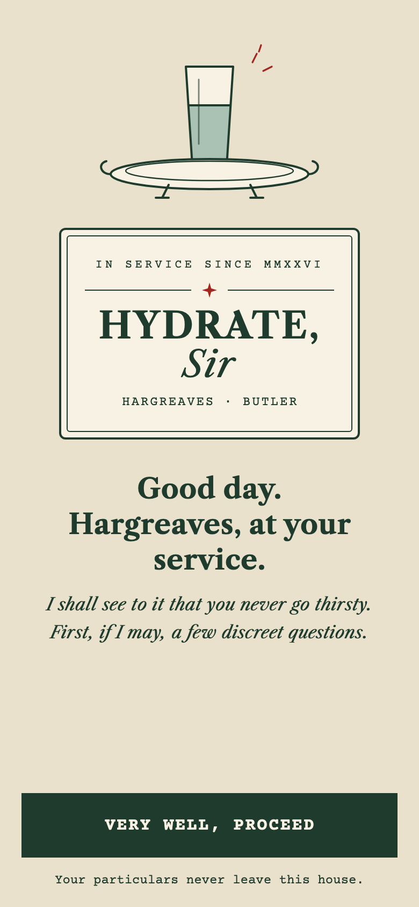
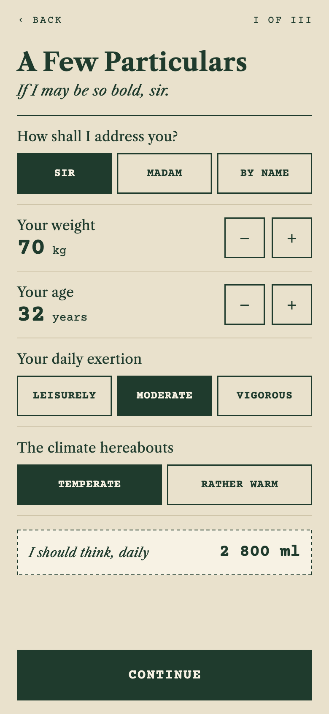
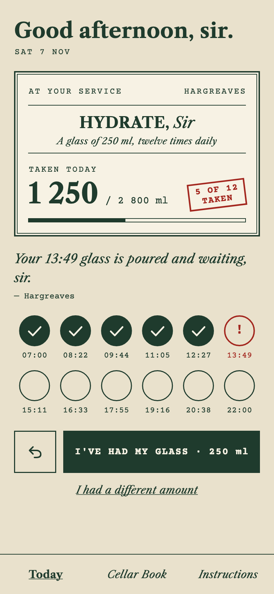
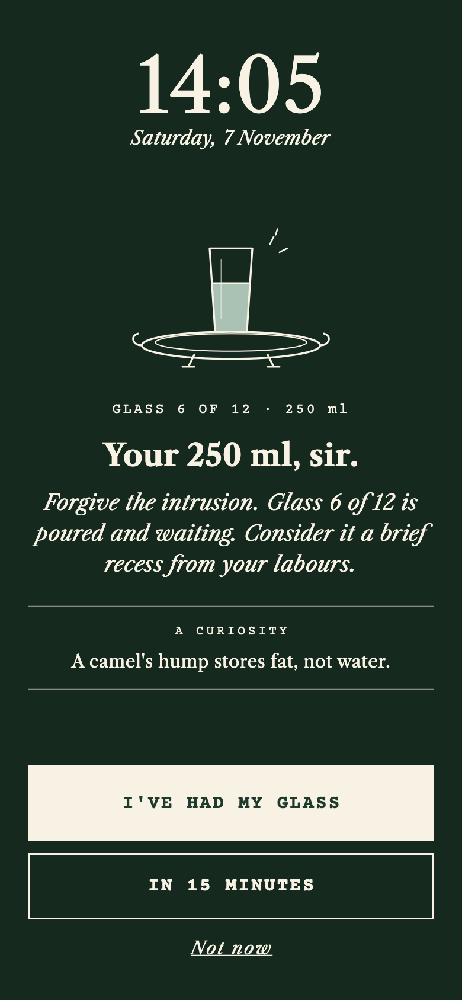
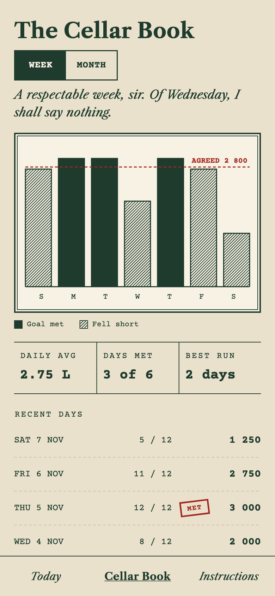
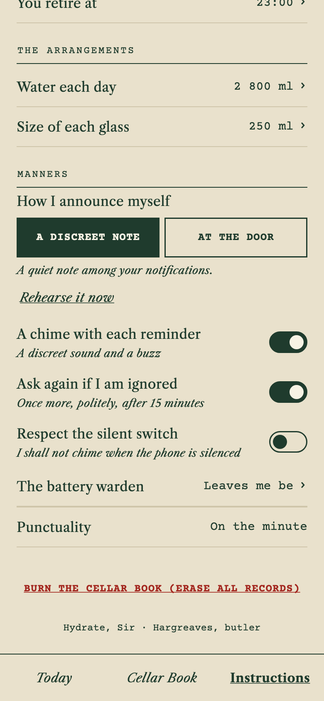

# Hydrate, Sir

*A water reminder for Android, attended to by your butler.*

---

Good day.

My name is Hargreaves, and I have the honour of seeing to it that you never go thirsty. I shall work out how much water you ought to take, divide it into sensible glasses, and bring each one at the proper hour, with a kind word and, if I may, a small curiosity to go with it.

I do not nag. I do not scold. I apologise before interrupting, and I keep quiet an hour before you retire.

## What I shall do for you

<table>
<tr>
<td width="33%" valign="top"> <b>A few particulars.</b> Your weight, your age, how active you are and how warm it is hereabouts. From these I propose a daily amount, which you are quite at liberty to correct.</td>
<td width="33%" valign="top"> <b>The day at a glance.</b> Each glass has its hour. Tick one off with a single tap, or tell me you had a different amount.</td>
<td width="33%" valign="top"> <b>At the door.</b> I arrive as a discreet note, or, should you prefer, in full over the locked screen, until you answer.</td>
</tr>
<tr>
<td valign="top"> <b>The Cellar Book.</b> A plain record of each day, week and month, with an honest remark and never a scolding.</td>
<td valign="top"> <b>Standing Instructions.</b> Amend anything you please: your hours, the size of each glass, whether I chime, and whether I ask again if ignored.</td>
<td valign="top"> <b>Particulars, kept private.</b> I keep no account and send nothing about you anywhere. My only errand outside is to ask GitHub, once a day at most, whether a new edition of myself has been published. Your records never leave this house.</td>
</tr>
</table>

## Engaging my services

1. Visit the **[Releases](https://github.com/saranshsinhaa/hydrate-sir/releases)** page from your Android telephone and fetch the latest `hydrate-sir-x.y.z.apk`.
2. Open the file. Android will ask whether your browser may install apps; allow it this once.
3. Open **Hydrate, Sir**, answer my few questions, and accept the arrangements.
4. When Android asks whether I may send notifications, do say yes. I shall also ask leave to arrive *on the minute*; that is worth granting too.

## New editions

I look for new editions of myself once a day and mention them on Today. Press **Fetch and install** and I shall bring it in; Android will ask you to confirm. The first time, Android will want you to permit me to install apps (*Allow from this source*), and Google Play Protect may offer to scan me, as it does with any app not from the Play Store.

I check each download against its published fingerprint before handing it over, and Android itself refuses any edition not signed by my maker. Should you prefer I never look, turn off **Instructions › Look for new editions daily**; **Enquire now** asks by hand.

## Should I keep you waiting

Some telephones keep a rather zealous **battery warden** who holds reminders at the door to save power. If my reminders arrive late, or not at all:

1. Open **Hydrate, Sir** and go to **Instructions › The battery warden**.
2. Press **Open the settings**, choose **Battery** (on some telephones, *App battery usage*) and set it to **Unrestricted**.

I shall then be entirely punctual.

## What I ask of your telephone

| Permission | Why |
|---|---|
| Notifications | To bring each glass |
| Alarms and reminders | To arrive on the minute rather than roughly |
| Full-screen notifications | Only if you choose "At the door" |
| Run at start-up | To resume my duties after the telephone restarts |
| Internet | Only to ask GitHub whether a new edition exists, and to fetch it |
| Install apps | Only to install a new edition you asked me to fetch |

Nothing more. I never ask for your location, your contacts or your files, and I send nothing about you anywhere.

## A word of caution

My suggestion is a sensible estimate for healthy adults; it is not medical advice. Your physician, naturally, outranks me.

---

For the mechanically minded: [running it yourself](docs/development.md) · [the design](docs/design.md) · [house rules for contributors](AGENTS.md)
